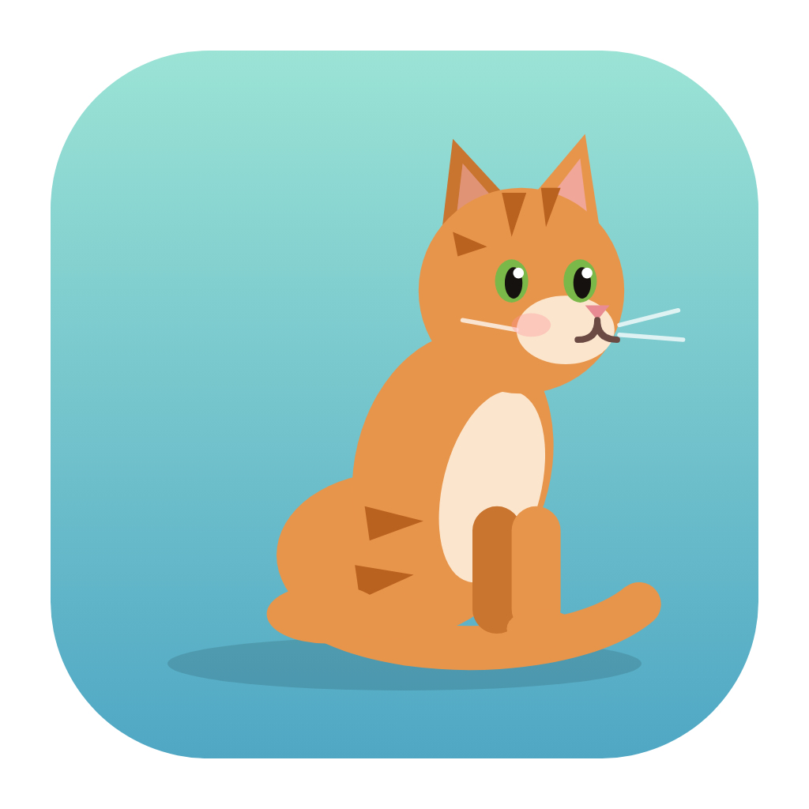
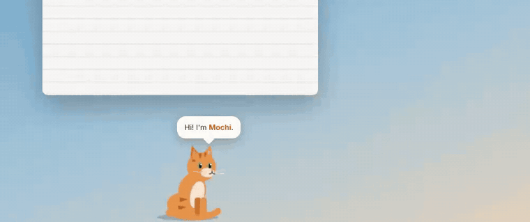
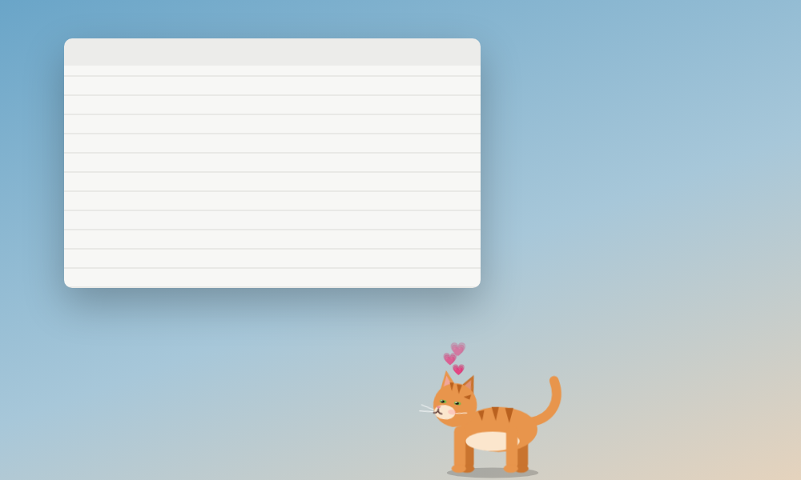
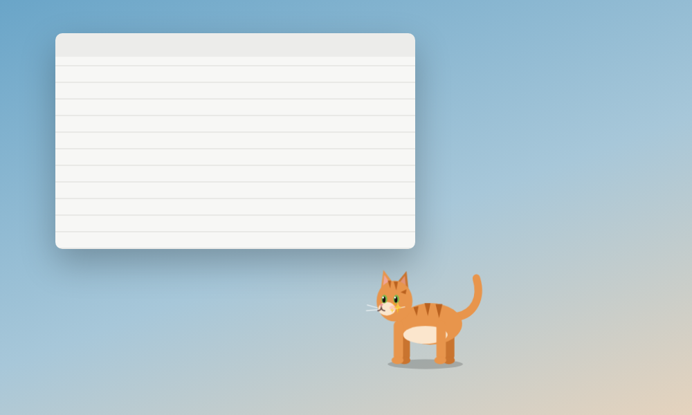
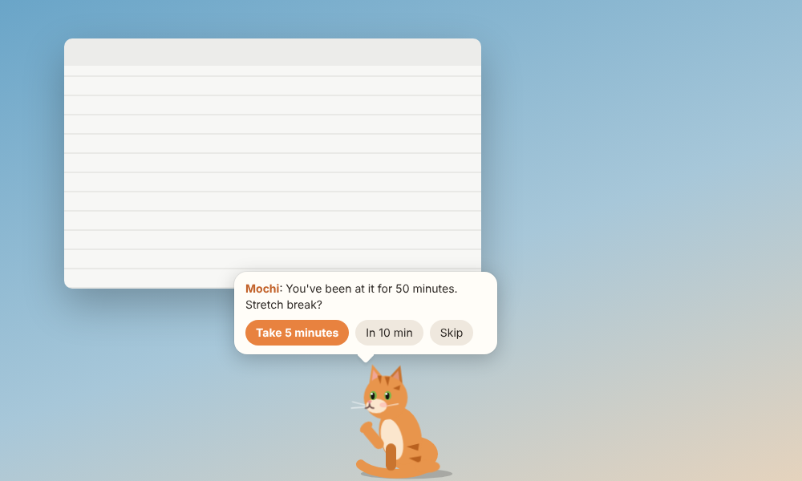
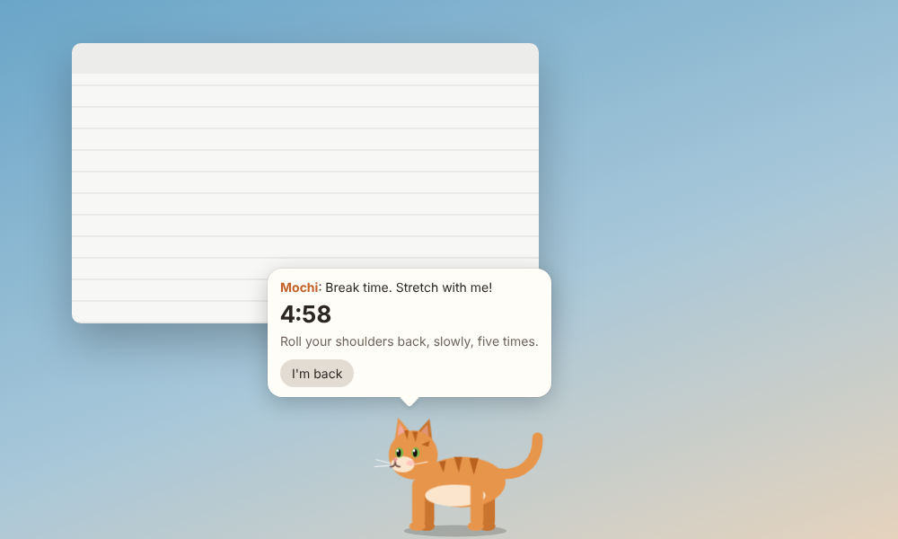
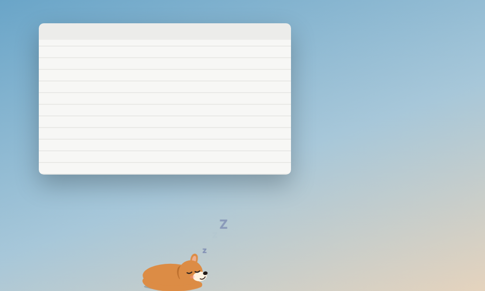
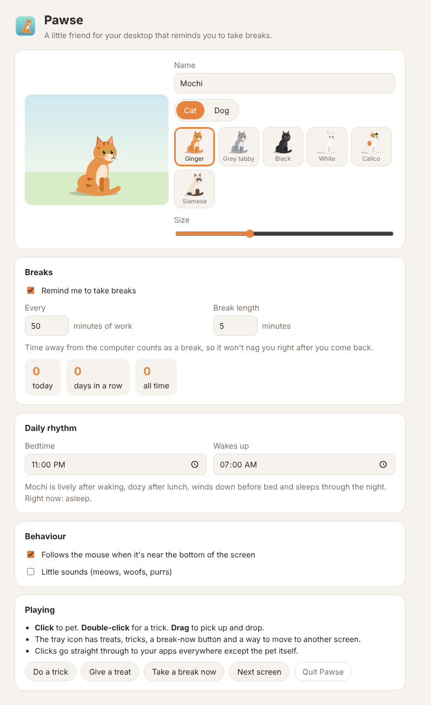
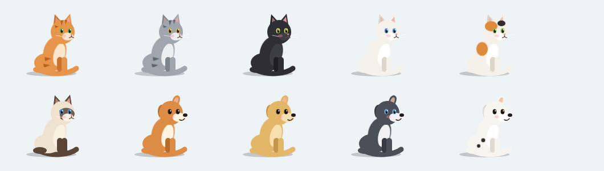

<div align="center">



# Pawse

**A little pet that lives on your desktop and reminds you to take breaks.**
A cat or a dog walks along the bottom of your screen, naps, plays, goes to bed at night, and every so often comes over to ask you to stretch.
Free and open source. No account, no subscription, nothing leaves your computer.

Windows · macOS · Linux



[Demo video (MP4)](docs/demo.mp4) · [Install](#install) · [What it does](#what-it-does) · [Compared to paid apps](#compared-to-paid-desktop-pet-apps)

</div>

---

## Install

**Windows** (PowerShell, installs for your user only, no admin needed):

```powershell
irm https://raw.githubusercontent.com/llamaboi55/pawse/main/scripts/install.ps1 | iex
```

**macOS and Linux:**

```sh
curl -fsSL https://raw.githubusercontent.com/llamaboi55/pawse/main/scripts/install.sh | sh
```

Both commands download the latest release straight from GitHub and install it. Files fetched this way don't get flagged, so there's no "unknown publisher" warning to click through. Run the same command again to update. You can also download the installer for your system from [Releases](https://github.com/llamaboi55/pawse/releases/latest).

**Build it yourself** (needs [Rust](https://rustup.rs) and Node.js 18+; on Linux also the [Tauri packages](https://tauri.app/start/prerequisites/)):

```sh
git clone https://github.com/llamaboi55/pawse && cd pawse && npm install && npm run build
```

**Just meet the pet** (no install): `npm run preview`, then open the printed address. It shows the pet on a pretend desktop.

## What it does

**A pet with a life of its own.** It wanders along the bottom of your screen, sits, grooms, yawns, stretches and naps. It's full of beans in the morning, dozy after lunch, winds down in the evening and sleeps through the night (you set its bedtime). When it's near, it chases your mouse.

**Play with it.** Click to pet it (hearts, and a purr if sounds are on). Double-click for a trick: jump, roll, spin or wave. Drag to pick it up and drop it. Give it a treat from the tray icon.

**Break reminders that don't nag.** After 50 minutes of work (you choose), it walks to the middle of the screen, waves and asks for a stretch break. Take one and it stretches with you, with a countdown and a new stretch idea every 45 seconds. Or snooze for 10 minutes, or skip. Time away from the keyboard and mouse counts as a break, so it won't ask right after you come back. Settings show breaks today, your streak and the total.

**Out of your way.** Clicks go straight through to your apps everywhere except the pet itself and its speech bubble. Hide it, move it to another screen or pause reminders for an hour from the tray.

**Ten pets.** Cats in ginger, grey tabby, black, white, calico and Siamese; dogs in shiba, golden, husky and spotty. Name it and pick its size.

| | |
|---|---|
|  |  |
|  |  |
|  |  |



## Compared to paid desktop pet apps

| | Pawse | Typical paid app |
|---|---|---|
| Price | Free | free to try, pay for your own pet |
| Linux | ✅ | ❌ Mac and Windows only |
| Account needed | No | yes |
| Walks, naps, tricks, petting | ✅ | ✅ |
| Daily rhythm, sleeps at night | ✅ | ✅ |
| Break reminders with a stretch countdown | ✅ | ✅ |
| Time away counts as a break | ✅ | ❌ |
| Works offline, nothing sent to the cloud | ✅ | ❌ cloud AI |
| Open source | ✅ | ❌ |

## Privacy

Your pet, settings and break count stay on your computer. To know when you've stepped away, Pawse asks the system how long since the last key press or mouse move. It never sees what you type or what's on screen. It never connects to the internet.

## Good to know

- **Linux:** the see-through window needs a compositor (GNOME, KDE, Cinnamon and most modern desktops have one). Idle time comes from X11; on Wayland Pawse goes by mouse movement instead, so long stretches of typing without touching the mouse may count as time away.
- The pet stays on top of other windows along the bottom of the screen, above the taskbar or dock.
- If you change your screen setup, use **Move to the next screen** in the tray to put the pet back where you want it.

## Development

```sh
npm install
npm run preview      # the pet on a pretend desktop in your browser, no Rust build needed
npm run dev          # the real app with hot reload
npm test             # rhythm and break tests (node --test) and Rust tests
```

Preview options: `?time=23:30` pretends it's that time, `?every=1&len=1` makes breaks come every minute.

- `src/js/art.js`: the pet, one SVG with three poses and ten coats; moves are in `src/css/pet.css`
- `src/js/brain.js`: the daily rhythm and what to do next (tested)
- `src/js/breaks.js`: counting work time and breaks (tested)
- `src/js/pet.js`: the pet window: movement, petting, tricks, carrying, speech bubbles
- `src/js/settings.js`: the settings window
- `src-tauri/src/lib.rs`: the see-through strip along the bottom of the screen, letting clicks through except on the pet, tray menu
- `src-tauri/src/idle.rs`: time since the last key press or mouse move on each system

Releases are built for all three systems by GitHub Actions whenever the version in `src-tauri/tauri.conf.json` changes on `main`.

## Where the idea came from

Found through this Instagram Reel: https://www.instagram.com/p/DdZlq5agurS/ (and similar ones: https://www.instagram.com/p/DeFf4J7kp_o/, https://www.instagram.com/p/DZNGt0qCH2d/)
This project isn't affiliated with the app shown there.

## License

MIT. Pawse is an independent project and isn't affiliated with any other desktop pet app.
